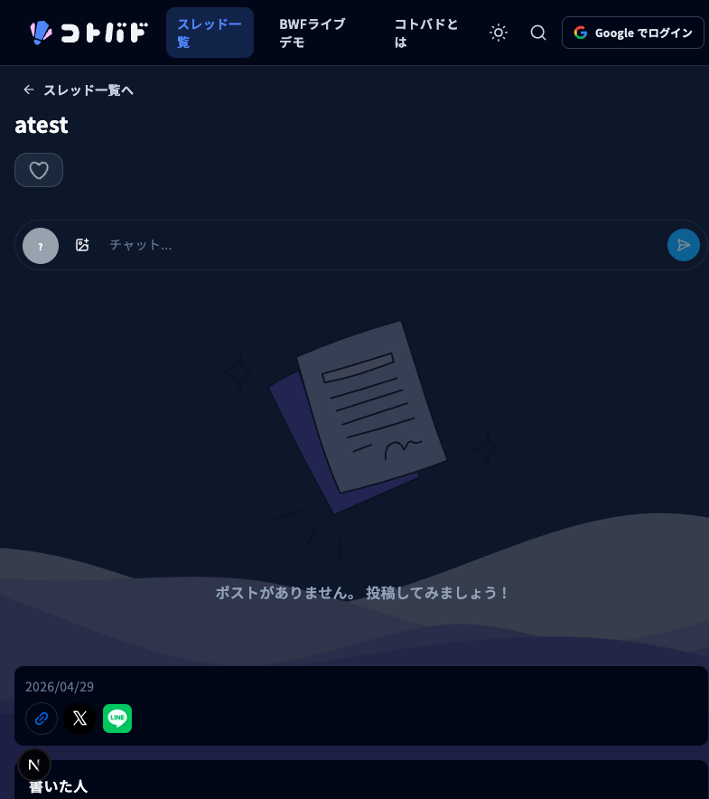
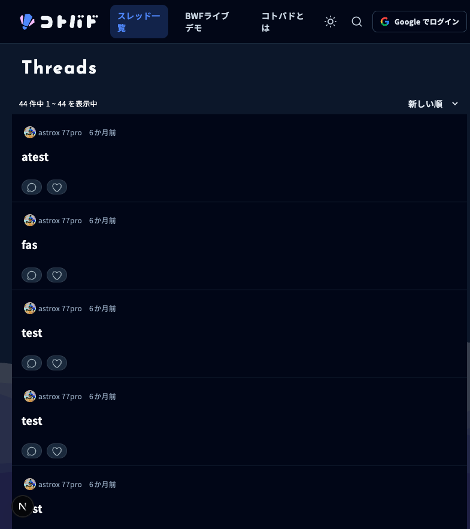
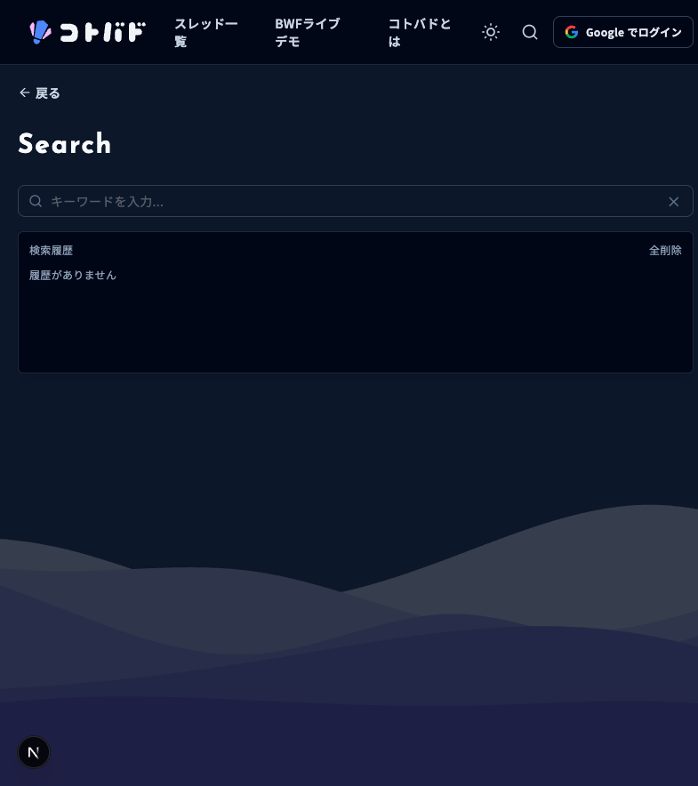
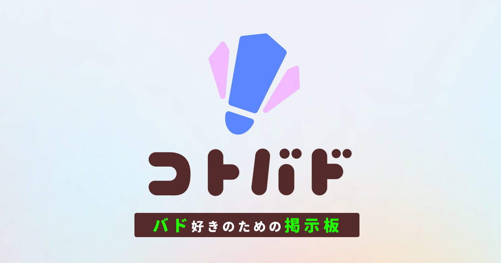

# kotobad

バドミントン特化の掲示板 Web サイト

交流の場に、試合通知とライブスコアを足した

技育展2026 オンライン予選 / チーム 劇団ひとり / tatu

---

<!-- _class: invert -->

## バドミントンは、マイナースポーツ

### 専用の交流の場がない

---

<!-- _class: invert -->

# 情報が、あちこちに散らばる

- SNS やチャットに会話が分散
- 試合の通知や結果を追う手段が乏しい
- コミュニティが盛り上がりにくい

---

## kotobad が解決する

### 掲示板 × 試合通知 × ライブスコア

---

## 主な機能

- 掲示板: ユーザーがスレッドを立てて会話
- 自動スレッド: 試合ごとに自動生成、ライブチャット
- 試合通知: 気になる試合の通知を受け取る
- ライブスコア: 進行中の点数をリアルタイム表示

---

## 実際の画面: スレッド一覧

---

## 実際の画面: スレッド詳細

---

## ユーザー体験にこだわる

- PWA 対応、ホーム画面から起動
- クリック時のローディングアニメーション
- モバイル最適化のナビゲーション
- プルトゥリフレッシュ

---

## 使用技術

 Next.js 16　 React 19　 TypeScript
 Hono　 Cloudflare　 Zod
 Drizzle　 Bun　 Radix UI
 Tailwind　 Google OAuth

フロントエンド: Next.js / バックエンド: Hono / DB: Cloudflare D1 / 保存: R2

---

## システム構成

- ユーザー / PWA → Next.js 16 Frontend Worker
- Next.js BFF → (Cookie + HMAC) → Hono Backend Worker
- Hono Backend → (Drizzle) → D1 (掲示板 + 認証)
- Hono Backend → R2 (画像)
- ユーザー → (WebSocket) → Hono → ThreadRoom Durable Object → (post.created) → ユーザー
- Frontend → OpenNext Cache (R2 + D1 + DO Queue)

---

## リアルタイム: WebSocket + Durable Objects

- Thread 単位の Durable Object が socket を集約
- 新規投稿時に post.created を通知
- 通知を受けたら SWR で D1 の正本を再取得
- WebSocket は変更通知、HTTP は正本取得

---

## 型安全: 共有 Zod スキーマ

- Frontend と Backend で同じ Zod を共有
- Validation、OpenAPI、TypeScript 型、Response 検証を一つの契約から
- HTTP 境界の runtime data を検査

Shared Zod Schema: Thread / Post / User / Notification / Tag / Media / Reaction / Error

---

## キャッシュと静的アセット保護

- ライブデータは no-store、タグは 5 分、静的は 1 年 immutable
- iOS で古い CSS が削除済み woff2 を要求し 404 連発した障害
- R2 スナップショットで前回参照 asset を検査
- 欠落時は本番 origin から復旧、復旧不能なら build 失敗

---

<!-- _class: invert -->

## セキュリティへのこだわり

18

OpenAPI 登録 API

48

テスト (37+11)

- AI に一任せず、XSS / CSRF を自分の目で確認
- ペネトレーションテストを実施
- HMAC + CSRF + Origin の多層防御

---

<!-- _class: invert -->

## データベース設計

- Cloudflare D1 + Drizzle ORM
- threads / posts / tags / reactions / notifications
- (threadId, localId) の unique 制約で採番競合を防ぐ
- 最大 3 回リトライ

---

<!-- _class: invert -->

## 地味なこだわり

- ロゴ (文字とアイコン) を自作
- PWA 対応、プルトゥリフレッシュ、ボトムナビ
- Safe area、Reduced motion 対応

 

---

## 今後の展望

- モバイルネイティブアプリの開発
- オフライン対応の強化
- Web Push 通知
- コミュニティの拡大

---

<!-- _class: invert -->

## まとめ

- バドミントン特化の掲示板 + 試合通知 + ライブスコア
- Cloudflare 上に集約したフルスタック構成
- リアルタイム通知と型安全な API 契約
- UX とセキュリティへのこだわり

kotobad.com / github.com/nematatu/kotobad / youtube.com/watch?v=Hrrha3mdc2s

---

<!-- _class: invert -->

# ありがとうございました

ご質問をお待ちしています

kotobad.com / github.com/nematatu/kotobad
