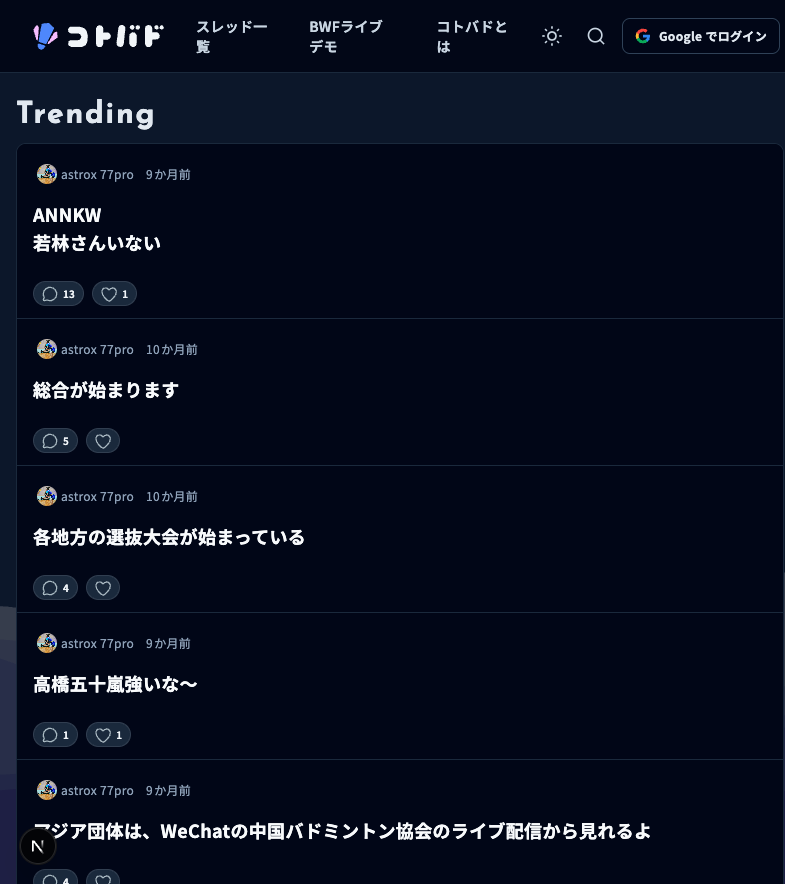
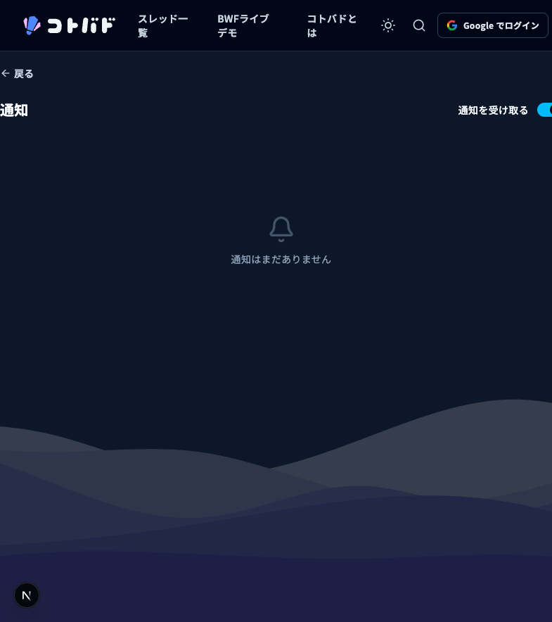
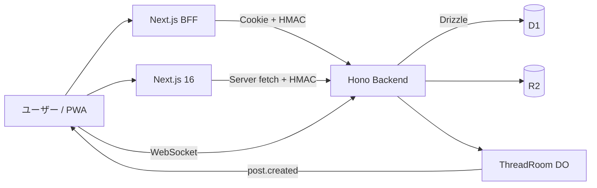
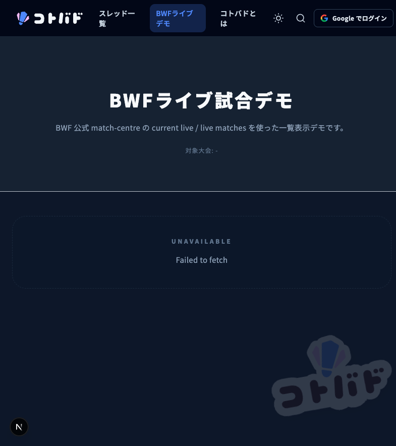
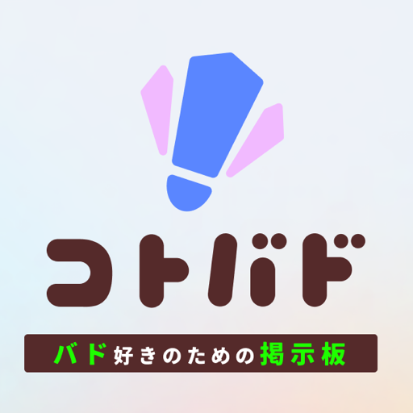

# kotobad

バドミントン特化の掲示板 Web サイト

交流の場に、試合通知とライブスコアを足した

  技育展2026 オンライン予選
  チーム 劇団ひとり
  tatu

  

---
layout: center
class: text-center invert
---

# バドミントンは、マイナースポーツ

## 専用の交流の場がない

---
layout: center
class: text-center invert
---

# 情報が、あちこちに散らばる

- SNS やチャットに会話が分散
- 試合の通知や結果を追う手段が乏しい
- コミュニティが盛り上がりにくい

---

# kotobad が解決する

## 掲示板 × 試合通知 × ライブスコア

---

# 主な機能

### 掲示板

ユーザーがスレッドを立てて会話

### 自動スレッド

試合ごとに自動生成、ライブチャット

### 試合通知

気になる試合の通知を受け取る

### ライブスコア

進行中の点数をリアルタイム表示

---
layout: center
class: text-center
---

# 実際の画面: スレッド一覧

---
layout: center
class: text-center
---

# 実際の画面: スレッド詳細

---

# ユーザー体験にこだわる

- PWA 対応、ホーム画面から起動
- クリック時のローディングアニメーション
- モバイル最適化のナビゲーション
- プルトゥリフレッシュ

---

# 使用技術

Next.js 16

React 19

TypeScript

Hono

Cloudflare

Zod

Drizzle

Bun

Radix UI

Tailwind

Google OAuth

フロントエンド: Next.js / バックエンド: Hono / DB: Cloudflare D1 / 保存: R2

---
layout: center
class: text-center
---

# システム構成

---

# リアルタイム: WebSocket + Durable Objects

- Thread 単位の Durable Object が socket を集約
- 新規投稿時に post.created を通知
- 通知を受けたら SWR で D1 の正本を再取得
- WebSocket は変更通知、HTTP は正本取得

---

# 型安全: 共有 Zod スキーマ

- Frontend と Backend で同じ Zod を共有
- Validation、OpenAPI、TypeScript 型、Response 検証を一つの契約から
- HTTP 境界の runtime data を検査

Shared Zod Thread / Post / User / Notification / Tag / Media / Reaction / Error

Hono Backend createRoute + RouteHandler&lt;typeof route&gt;

---

# キャッシュと静的アセット保護

- ライブデータは no-store、タグは 5 分、静的は 1 年 immutable
- iOS で古い CSS が削除済み woff2 を要求し 404 連発した障害
- R2 スナップショットで前回参照 asset を検査
- 欠落時は本番 origin から復旧、復旧不能なら build 失敗

---
layout: center
class: text-center invert
---

18

# OpenAPI 登録 API

48

## テスト (37+11)

---

# セキュリティへのこだわり

- AI に一任せず、XSS / CSRF を自分の目で確認
- ペネトレーションテストを実施
- HMAC + CSRF + Origin の多層防御

---
layout: center
class: text-center invert
---

# データベース設計

- Cloudflare D1 + Drizzle ORM
- threads / posts / tags / reactions / notifications
- (threadId, localId) の unique 制約で採番競合を防ぐ
- 最大 3 回リトライ

---
layout: center
class: text-center invert
---

# 地味なこだわり

  
  

- ロゴ (文字とアイコン) を自作
- PWA 対応、プルトゥリフレッシュ、ボトムナビ
- Safe area、Reduced motion 対応

---

# 今後の展望

- モバイルネイティブアプリの開発
- オフライン対応の強化
- Web Push 通知
- コミュニティの拡大

---
layout: center
class: text-center invert
---

# まとめ

- バドミントン特化の掲示板 + 試合通知 + ライブスコア
- Cloudflare 上に集約したフルスタック構成
- リアルタイム通知と型安全な API 契約
- UX とセキュリティへのこだわり

  kotobad.com
  github.com/nematatu/kotobad
  youtube.com/watch?v=Hrrha3mdc2s

---
layout: center
class: text-center invert
---

# ありがとうございました

ご質問をお待ちしています

  kotobad.com
  github.com/nematatu/kotobad

  

